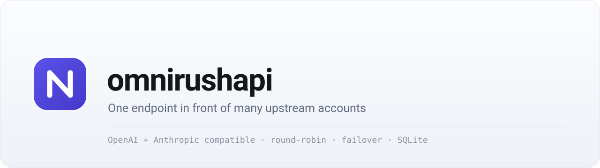
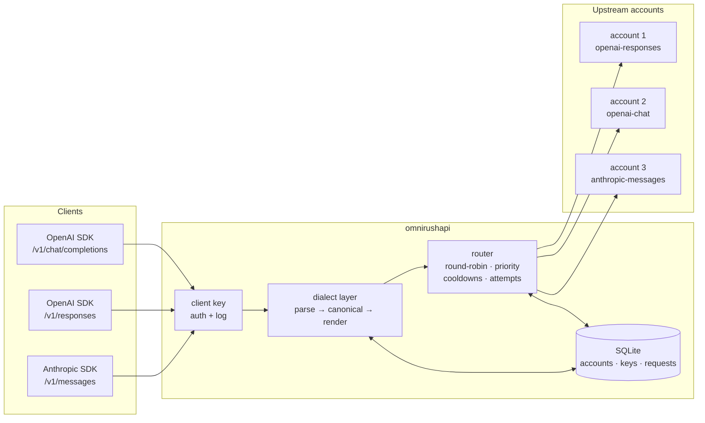

<picture>
  <source media="(prefers-color-scheme: dark)" srcset="assets/banner-dark.svg">
  
</picture>

# omnirushapi

**One endpoint in front of many upstream accounts.** A self-hosted gateway that speaks the
OpenAI and Anthropic APIs to your clients, talks to each upstream account in whatever dialect
that account needs, and switches accounts when one fails.

[](https://github.com/hirotomasato/omnirushapi/actions/workflows/ci.yml)
[](LICENSE)
[](https://nodejs.org)
[](#why-so-small)

---

## Why

An account is a credential plus a wire format plus a set of quirks. Every client you own wants
one base URL and one key. This gateway sits in the middle: it keeps the accounts, picks one per
request, translates between the three dialects, retries elsewhere when an upstream refuses, and
shows you what happened.

It exists because of four problems that show up the moment you have more than one upstream
account:

- **Different wire formats.** One account wants OpenAI chat, another wants OpenAI responses,
  a third wants Anthropic messages. Clients should not care.
- **One account is not enough.** Free tiers, per-key limits and rate limits mean a refusal is
  normal traffic, not an incident. A refusal should move the call, not fail it.
- **Tokens expire.** Device-flow and OAuth accounts rotate their tokens, and a rotated token
  taken by two concurrent requests is what signs a device out.
- **You want to see the numbers.** What went through the gateway, what is left on an account as
  the provider itself counts it, and which call failed and why.

## Features

| | |
|---|---|
| **Three dialects** | OpenAI chat completions, OpenAI responses, Anthropic messages — as both the client-facing and the upstream format, streaming and whole, tools included. |
| **Translation** | Same dialect on both sides: the request and the stream pass through byte for byte. Different: one canonical model in the middle. |
| **Routing** | Round-robin or least-used across enabled accounts, ordered by priority, ties broken by weight. |
| **Failover** | Every attempt is logged; a refusing account is parked with a cooldown (longer when it looks dead) and the request is retried on another account. |
| **Credential renewal** | Device-flow sign-in, proactive renewal near expiry, renew-and-retry when an upstream refuses a token, and one refresh per account when callers race. |
| **Per-account quirks** | Flags, not branches in the translator: force streaming, drop sampling parameters, extra headers. A provider's oddities live in its preset. |
| **Console** | Six server-rendered pages: overview, accounts, models, client keys, usage, requests. Device login, account and key management, provider-reported quota. |
| **CLI and admin API** | The same operations from a terminal or a script, behind an admin token. |
| **Transport that survives a proxy** | Upstream traffic goes through `curl` when a proxy is configured (undici's proxy agent does not survive every TLS-inspecting proxy), uncompressed, streaming, with retries around transport blips. |
| **SQLite** | One file, additive migrations, no service to run. |

## How it works



A request, in order:

1. The client key is checked (`authorization: Bearer sk-gw-…` or `x-api-key: sk-gw-…`) and the
   call is recorded against it.
2. The body is parsed once into the canonical shape for the client's dialect.
3. The router orders the enabled accounts (priority, then strategy) and picks the first.
4. If the account's dialect differs from the client's, the canonical request is rendered in it;
   a matching dialect is forwarded untouched.
5. The upstream answers. Usage, status and latency are recorded, and the account's cooldown is
   cleared or set from what came back.
6. The response is rendered back in the client's dialect — streaming events are translated one
   by one, so the client sees a stream it recognises.

<details>
<summary>Why the transport shells out to curl</summary>

Node's `fetch` ignores `HTTP(S)_PROXY`, and undici's `ProxyAgent` does not survive every
TLS-inspecting corporate proxy (it dies mid-handshake where curl is fine). When a proxy is
configured, upstream requests are handed to `curl` — streaming, uncompressed, with loopback
upstreams staying direct. Nothing is buffered beyond the response headers.
</details>

## Quickstart

Needs **Node 22 or newer** and `curl` on the box (the upstream transport). No build step: the
TypeScript runs through `tsx`.

```bash
git clone https://github.com/hirotomasato/omnirushapi.git
cd omnirushapi
npm ci
npm start
```

First start prints the admin token once (it is minted into the database and kept there):

```
omnirushapi 0.1.0 listening on http://127.0.0.1:8787
  data plane : http://127.0.0.1:8787/v1   (Authorization: Bearer <gateway key>)
  admin API  : http://127.0.0.1:8787/admin (x-admin-token: <admin token>)
  database   : data/gateway.db   routing: round-robin
  admin token (minted, kept in the database): 9f4c…
```

Then, in the browser:

1. **http://127.0.0.1:8787/dashboard** — sign in (`admin` / `admin` by default; a placeholder
   password is refused when the gateway is not on loopback, so set `DASHBOARD_PASSWORD`).
2. **Accounts → Sign in to a provider** — approve the device code in the browser; the account
   is filed with the provider's dialect, headers and a refresh token, and renews itself.
   Providers that only take a static key go in **Add a provider by hand**.
3. **Client keys → Create key** — the secret is shown once. Copy it.
4. Call the gateway with any OpenAI or Anthropic client:

```bash
export OPENAI_BASE_URL=http://127.0.0.1:8787/v1
export OPENAI_API_KEY=sk-gw-…

curl -sS "$OPENAI_BASE_URL/chat/completions" \
  -H "authorization: Bearer $OPENAI_API_KEY" -H "content-type: application/json" \
  -d '{"model":"gpt-6-astra","messages":[{"role":"user","content":"hello"}]}'
```

The Claude-shaped path works with the same key, using Anthropic's header:

```bash
curl -sS http://127.0.0.1:8787/v1/messages \
  -H "x-api-key: $OPENAI_API_KEY" -H "anthropic-version: 2023-06-01" \
  -H "content-type: application/json" \
  -d '{"model":"gpt-6-astra","max_tokens":64,"messages":[{"role":"user","content":"hello"}]}'
```

## Endpoints

| Path | Client dialect | Notes |
|---|---|---|
| `POST /v1/chat/completions` | OpenAI chat completions | Streaming and whole, `tools` included. |
| `POST /v1/responses` | OpenAI responses | Streaming events translated back; input items accepted. |
| `POST /v1/messages` | Anthropic messages | `x-api-key` or `Bearer`; `max_tokens` required as usual. |
| `GET /v1/models` | OpenAI | The union of what the accounts advertise, cached. |
| `GET /healthz` | — | Unauthenticated liveness. |
| `/dashboard…` | — | The console, cookie session or `x-admin-token`. |
| `/admin…` | — | JSON admin API, `x-admin-token`. |

Client authentication: `authorization: Bearer sk-gw-…` or `x-api-key: sk-gw-…`. The model id is
passed through to the upstream; pick one from **Models** in the console.

### Compatibility

Every client dialect can reach every upstream dialect. The gateway translates in both
directions, including streaming and tool calls:

| Client ↓ / Upstream → | `openai-chat` | `openai-responses` | `anthropic-messages` |
|---|---|---|---|
| `/v1/chat/completions` | pass-through | translated | translated |
| `/v1/responses` | translated | pass-through | translated |
| `/v1/messages` | translated | translated | pass-through |

"Pass-through" means the request body and response bytes are forwarded untouched — the path
that has been tested against a live provider. Anything else goes through the canonical model,
which is where the work (and the tests) are: system turns, tool calls and stream events are
mapped both ways.

## Console

Six pages, one job each, server-rendered — no client framework, no CDN, no bundler.

| Page | What it answers |
|---|---|
| `/dashboard` | accounts ready/cooling/dead, requests and tokens over 24 h, provider quota per account, a copy-paste call, the runtime limits in force |
| `/dashboard/accounts` | sign in to a provider (device flow), add one by hand, edit, enable/disable, reset a cooldown, ask a provider for its quota, delete |
| `/dashboard/models` | the catalog the accounts advertise: id, owner, context and output limits, capabilities, which account serves it, which dialect that account speaks |
| `/dashboard/keys` | create a key (shown once), enable/disable, delete, how a client calls the gateway |
| `/dashboard/usage` | requests, tokens and errors over 24 h, 7 d or 30 d, grouped by account, client key and model |
| `/dashboard/requests` | the most recent calls, newest first, with an errors-only filter |

Details that matter in daily use:

- Actions are posts that answer `303` and hand the browser a `GET`, so a refresh never repeats
  one; the result is shown once and then stripped from the address bar.
- Pages refresh themselves every 15 s, but never while a field has focus or a panel is open,
  and never in a tab nobody is looking at — coming back to the tab refreshes at once.
- Two counters are always labelled: **through this gateway** (what the gateway counted) and
  **provider** (what the provider's manager says is left today, with the weekly cap and the
  reset time). The provider is asked at most once every five minutes, and a token it refuses is
  renewed and the question asked again.

## Providers

A provider is a preset in `src/providers.ts`: origin, API base, dialect, the headers an account
should carry, the quirks that account needs, and the path that reports its quota.

| Provider | Dialect | Account headers | Quirks | Quota |
|---|---|---|---|---|
| `omnirush` | OpenAI responses | `user-agent: omnirush`, `x-omnirush-client: cli/…` | force streaming, drop `temperature`/`top_p` | `/device/me` → `usage.day`, `usage.week`, `usage.pot` |

Signing in uses the device flow (`/device/authorize`, `/device/token`, `/device/refresh`,
`/device/me`), so any provider that speaks the same flow can be added by pointing at its manager
origin — from the console's origin field or `login --origin`. Providers with a static key need
nothing but a base URL, a key and a dialect.

Two quirks are per-account flags rather than translator branches, because they describe the
upstream and not the format:

- `force_stream` — the upstream only answers streaming requests;
- `strip_sampling` — the upstream rejects `temperature`, `top_p` and friends.

## CLI

```bash
npm run gateway -- <command> [--url <base>] [--token <admin token>] [--json]
```

| Command | What it does |
|---|---|
| `status` | health, account counts, keys, strategy |
| `providers` | the presets that can be signed into |
| `login <provider>` | device-flow sign-in; files the account with a refresh token (`--label`, `--origin`, `--account-id`, `--no-open`) |
| `account add \| patch \| list \| get \| rm \| enable \| disable \| reset \| quota` | account management, including asking the provider for its quota |
| `key add \| list \| rm \| enable \| disable` | client keys |
| `usage [--since ISO] [--group account\|key\|model]` | token accounting |
| `requests [--limit N]` | the request log |

`--no-open` is what you want on a server: the code and the approval URL are printed instead of
opening a browser.

## Admin API

`/admin/*` with an `x-admin-token` header. Errors are `{ error: { type, message } }`, answers
are `{ data: … }`.

| Method | Path |
|---|---|
| `GET` | `/admin/health` |
| `GET`, `POST` | `/admin/accounts` |
| `GET`, `PATCH`, `DELETE` | `/admin/accounts/:id` |
| `POST` | `/admin/accounts/:id/enable`, `/admin/accounts/:id/reset`, `/admin/accounts/:id/quota` |
| `GET`, `POST` | `/admin/keys` |
| `DELETE` | `/admin/keys/:id` |
| `POST` | `/admin/keys/:id/enable` |
| `GET` | `/admin/usage?since=&group=`, `/admin/requests?limit=` |

`/admin/accounts/:id/quota` asks the provider and returns the fresh snapshot; `PATCH` takes any
subset of `label`, `base_url`, `api_key`, `provider`, `dialect`, `force_stream`, `strip_sampling`,
`priority`, `weight`, `quota_limit`, `quota_reset_at`, `extra_headers`, `enabled`,
`refresh_token`, `token_expires_at`, `oauth_origin`.

## Configuration

Everything has a default except `ADMIN_TOKEN`. Copy `.env.example` to `.env` (both `npm start`
and `npm run gateway` load it when it exists) or set the variables in the environment.

| Variable | Default | Meaning |
|---|---|---|
| `HOST` | `127.0.0.1` | listen address — anything but loopback needs a real dashboard password |
| `PORT` | `8787` | listen port |
| `DB_PATH` | `data/gateway.db` | the SQLite file: accounts, keys, request log, admin token |
| `ADMIN_TOKEN` | minted | `/admin` and scripted console access; minted into the database on first start and printed once |
| `ROUTING` | `round-robin` | `round-robin` or `least-used` |
| `MAX_ATTEMPTS` | `3` | accounts tried per request |
| `UPSTREAM_TIMEOUT_MS` | `600000` | deadline per attempt (generous: long streams are normal) |
| `COOLDOWN_MS` | `60000` | how long a refusing account is parked |
| `DEAD_COOLDOWN_MS` | `3600000` | park time when failures look terminal |
| `TRANSPORT_COOLDOWN_MS` | `5000` | pause after a transport blip (empty reply, dropped connection) |
| `TRANSPORT_ATTEMPTS` | `3` | retries inside one attempt before it counts as a failure |
| `CATALOG_CACHE_MS` | `60000` | how long `/v1/models` and the Models page reuse an answer |
| `UPSTREAM_PROXY` | — | proxy for upstream calls; falls back to `HTTPS_PROXY`, `HTTP_PROXY`, `ALL_PROXY` |
| `CURL_BIN` | `curl` | the transport binary |
| `DASHBOARD_USER` | `admin` | console user |
| `DASHBOARD_PASSWORD` | `admin` | console password — a placeholder is refused when `HOST` is not loopback |
| `LOG_LEVEL` | `info` | Fastify log level |

To rotate the admin token, set `ADMIN_TOKEN` to what you want (it wins over the stored one) and
restart.

## Deployment

### npm, or systemd

`npm start` in a checkout is a complete deployment. For a service, `deploy/omnirushapi.service`
runs it as an unprivileged user with a hardened unit (no capabilities, read-only system, writes
only under its own `data/`):

```bash
sudo useradd --system --home /opt/omnirushapi --shell /usr/sbin/nologin omnirushapi
sudo git clone https://github.com/hirotomasato/omnirushapi.git /opt/omnirushapi
cd /opt/omnirushapi && sudo -u omnirushapi npm ci
sudo install -m 600 -o omnirushapi -g omnirushapi /dev/null /opt/omnirushapi/.env   # then edit it
sudo cp deploy/omnirushapi.service /etc/systemd/system/
sudo systemctl enable --now omnirushapi
```

### Docker

```bash
DASHBOARD_PASSWORD='pick-something-real' docker compose up -d
```

The image bundles `curl` (the upstream transport), keeps the database in a volume at `/data`,
runs as the unprivileged `node` user and has a `/healthz` health check. `docker compose config`,
`build` and the smoke test above run in CI on every push.

To sign in to a provider from inside the container, ask for the code without opening a browser
on the host:

```bash
docker compose run --rm gateway node --import tsx src/cli.ts login omnirush --no-open
```

Afterwards, put the gateway behind a TLS-terminating reverse proxy before it leaves the machine
— the console is plain HTTP and it can create, edit and delete credentials (see
[SECURITY.md](SECURITY.md)).

## Tests

```bash
npm run check      # typecheck + unit + end-to-end
npm run typecheck  # strict TypeScript, no emit
npm test           # unit: config, routing, SSE scanner, dialects, token refresher, quota, favicon
npm run e2e        # three suites against a stub upstream and manager, driving the real gateway
```

The end-to-end suites start a real gateway against a stub provider and check the paths that
matter: rotation and failover, body-level quota refusals, transport blips, streaming in every
dialect direction, tool calls both ways, device login with token renewal (including concurrent
rotation), and every console page and button. 45 unit cases and 82 end-to-end checks at the time
of writing; CI runs them on Node 22 and 24, and builds plus smoke-tests the container image.

## Limits and non-goals

- **One process.** Rotation carry is in memory, so a restart starts the round-robin over;
  accounts, keys and the request log live in SQLite.
- **One admin.** There is no multi-tenant split: whoever holds the console session or the admin
  token sees and can change everything.
- **The console is plain HTTP.** Keep it on loopback until a reverse proxy terminates TLS.
- **Accounting follows the upstream.** Tokens are counted from what a provider reports; an
  upstream that reports nothing shows blanks rather than a guess.
- **POSIX only in practice.** The systemd unit, the curl transport and the shell examples assume
  Linux or macOS; Windows has not been tried.
- **Your accounts, your terms.** The gateway fronts credentials you are entitled to use; what
  each provider allows is between you and that provider.

## License

[MIT](LICENSE).
